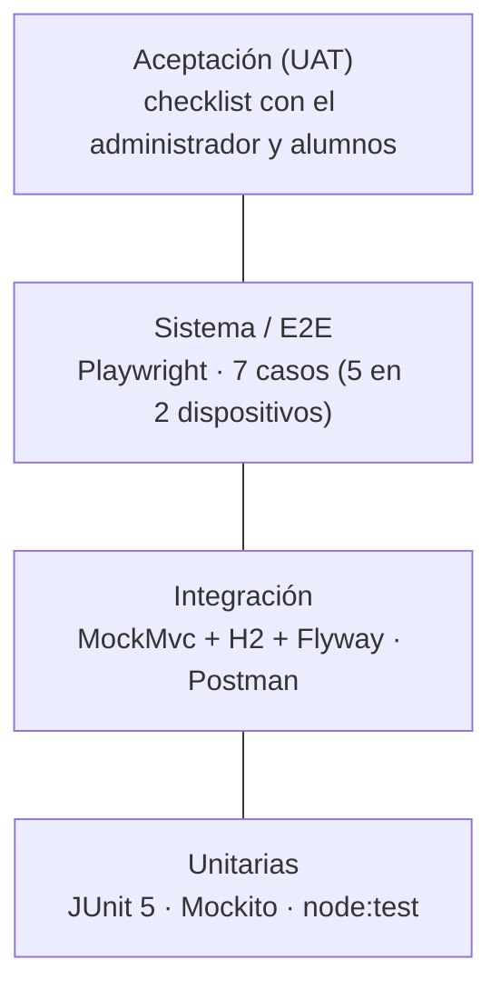

# 7. Plan de Pruebas de Software

> Documento formal que describe **cómo se probará** Matemática Sin Estrés: objetivos, alcance, estrategia, recursos, cronograma, responsabilidades, riesgos y criterios de finalización. Complementa la matriz de casos de [03-pruebas.md](03-pruebas.md) y los [requisitos no funcionales](05-requisitos-no-funcionales.md).

| Dato | Valor |
|------|-------|
| Sistema | Matemática Sin Estrés — Academia Virtual (front-end React + API Spring Boot + PostgreSQL) |
| Curso | Curso Integrador II — Pruebas e implementación de sistemas |
| Versión del plan | 1.0 |
| Responsable del plan | _[completar: nombre del QA / Scrum Master]_ |
| Fecha | _[completar]_ |

---

## 7.1 Objetivos

1. **Detectar defectos** antes de que lleguen a producción (ver el defecto DEF-001 en 7.12, hallado al diseñar las pruebas).
2. **Verificar los requisitos funcionales** (historias de usuario del [backlog](08-scrum-y-prototipos.md)) y los **no funcionales** ISO/IEC 25010.
3. **Reducir riesgos de seguridad** frente a los ataques más comunes (OWASP Top 10: inyección SQL, XSS, control de acceso roto, autenticación débil).
4. **Evaluar el rendimiento** bajo carga y estrés con un presupuesto medible (p95 < 500 ms).
5. **Asegurar que lo que ya funciona sigue funcionando** (regresión) en cada cambio, de forma automática.

## 7.2 Alcance

### Dentro del alcance

| Subsistema | Elementos a probar |
|------------|--------------------|
| Back-end — seguridad | Login/registro, JWT, bloqueo de cuenta, política de contraseñas, límite de peticiones, cabeceras, roles |
| Back-end — negocio | Matrículas (estados y vencimiento), clases grabadas (CRUD y acceso por nivel), progreso del alumno, solicitudes, auditoría, estadísticas |
| Back-end — datos | Migraciones Flyway V1–V4 y datos iniciales en H2 y PostgreSQL |
| Front-end | Registro, inicio de sesión, rutas protegidas, Aula del alumno, utilidades (formatos, fechas, horarios, política de contraseñas) |
| Integración extremo a extremo | Navegador → front-end → API → base de datos |

### Fuera del alcance (y motivo)

| Elemento | Motivo |
|----------|--------|
| Reproducción de los videos de las clases | Los videos están alojados en servicios externos (se guarda solo el enlace https) |
| Pasarela de pagos | El sistema no procesa pagos: la renovación se coordina por WhatsApp |
| Pruebas de penetración por terceros | Requieren autorización y un entorno dedicado; se cubren los ataques comunes con lotes automatizados (SEC-01…08) |

## 7.3 Estrategia de pruebas

Se aplica la **pirámide de pruebas**: muchas pruebas rápidas en la base, menos y más lentas arriba.

| Decisión | Elección | Razón |
|----------|----------|-------|
| ¿Manual o automatizada? | **Automatizada** para unitarias, integración, seguridad, rendimiento y E2E; **manual** para usabilidad con usuarios, compatibilidad en navegadores adicionales y aceptación | Lo repetitivo y estable se automatiza (regresión barata); lo que requiere juicio humano se hace con personas |
| ¿Cuándo se ejecuta? | En **cada *push*** mediante GitHub Actions (`ci.yml`) y en local antes de integrar | Detección temprana: un defecto es más barato cuanto antes se encuentra |
| ¿Cuál es el orden? | 1.º **humo** → 2.º suite completa + cobertura → 3.º E2E | Si el humo falla no se avanza (ver tipo *humo*) |
| ¿Cómo se escriben los casos nuevos? | Con **TDD** (rojo → verde → refactorizar) cuando es lógica nueva o un defecto (ver 7.13) | La prueba documenta el requisito y evita regresiones |

## 7.4 Tipos de pruebas

| Tipo | Qué comprueba | Casos | Archivo / herramienta | Comando |
|------|---------------|-------|-----------------------|---------|
| **Unitarias** | Una pieza aislada (política de contraseñas, JWT, generador, utilidades JS) | PasswordPolicyTest (14) · UNIT-01…15 · FMT-01…13 · PWD-F01…F08 · HOR-01…09 · CHAT-01…14 | JUnit 5 + Mockito + AssertJ · `node:test` | `mvn test -Dgroups=unitaria` · `npm test` |
| **Integración** | Que los componentes funcionen juntos: controlador + seguridad + servicio + BD real con migraciones | SeguridadIntegrationTest (26) · MejorasIntegrationTest (6) · ProgresoYAdminIntegrationTest (6) | MockMvc + H2 + Flyway | `mvn test` |
| **Funcionales (caja negra)** | Que el sistema cumpla lo especificado en las historias de usuario | Matriz 4.1 de [03-pruebas.md](03-pruebas.md) · Postman (42 peticiones) | MockMvc · Postman Runner | `mvn test` · Collection Runner |
| **Humo (*smoke*)** | Que lo esencial esté vivo antes de probar a fondo | HUM-01…04 (12 ejecuciones) | `PruebasHumoIntegrationTest` | `mvn test -Dgroups=humo` |
| **Regresión** | Que un cambio no rompa lo existente | **Toda la suite** se ejecuta en cada *push* | GitHub Actions | automático |
| **Rendimiento — comportamiento temporal** | p95 < 500 ms por endpoint público | RND-01 (5 endpoints) | `RendimientoIntegrationTest` | `mvn test -Dgroups=rendimiento` |
| **Carga** | Muchas peticiones simultáneas sin errores | RND-02 (300 peticiones, 20 hilos) | ídem | ídem |
| **Estrés** | Hasta dónde aguanta antes de fallar | RND-03 (10 → 40 → 80 hilos) | ídem | ídem |
| **Seguridad (ataques)** | Inyección SQL, XSS, JSON malformado, tipo de contenido y verbo erróneos, cabecera de autorización manipulada | SQLI-01/02 · XSS-01…03 · JWT-01…04 · SEC-01…08 (26 ejecuciones) | `SeguridadPayloadsIntegrationTest` | `mvn test -Dgroups=seguridad` |
| **Sistema / E2E** | Flujos completos en un navegador real | E2E-01…07 | Playwright (`e2e/`) | `cd e2e && npm test` |
| **Usabilidad** | Que las personas logren sus tareas con facilidad | Tareas T1…T6 y cuestionario SUS ([08 § 6](08-scrum-y-prototipos.md)) | Sesiones con usuarios | manual |
| **Compatibilidad** | Navegadores y dispositivos | E2E en Chrome escritorio y Pixel 7; manual en Firefox/Safari/Edge | Playwright + manual | `npx playwright test` |
| **Aceptación (UAT)** | Que el cliente confirme que el sistema sirve a su necesidad | Criterios de 7.11 | Checklist con el administrador | manual |

> Para ver los resultados de rendimiento, la salida de `mvn test -Dgroups=rendimiento` imprime líneas `[RND-0x] … p95=… ms` que se adjuntan como evidencia.

## 7.5 Niveles de prueba

| Nivel | Definición | Quién lo ejecuta | En este proyecto |
|-------|------------|------------------|------------------|
| **1. Unitaria** | Se prueba cada componente por separado, sin integrarlo con otros (también llamada prueba de módulo) | Desarrolladores | `PasswordPolicyTest`, `JwtServiceTest`, `GeneradorPasswordTest`, `AdminServiceMockitoTest` (Mockito aísla el repositorio), `tests/*.test.js` |
| **2. Integración** | Se prueba la combinación de componentes ya probados: comunicación, enlaces y datos compartidos | Desarrolladores | `*IntegrationTest` con la aplicación completa, seguridad real y base H2 con las migraciones reales |
| **3. Sistema** | Se verifica que todos los elementos están integrados y funcionan como un todo (alcance más amplio que integración) | QA / equipo | E2E con Playwright: navegador + front-end + API + BD |
| **4. Aceptación** | La realizan principalmente los usuarios con apoyo del equipo, en el entorno de explotación, para confirmar que el sistema está terminado y es aceptado | Cliente / usuarios finales | UAT sobre el despliegue en Render (7.11) |

## 7.6 Entorno de pruebas

| Elemento | Detalle |
|----------|---------|
| Hardware | Equipo de desarrollo (≥ 8 GB de RAM) y *runners* `ubuntu-latest` de GitHub Actions |
| Software | Java 17, Maven 3.9, Node.js 20, Chromium (instalado por Playwright) |
| Base de datos | **H2 en memoria** (modo PostgreSQL) para unitarias/integración/E2E local; **PostgreSQL 16** (Docker o Render) para validar migraciones y UAT |
| Datos de prueba | Datos iniciales de Flyway (3 niveles, 3 horarios, 6 clases, 2 cuentas). Cada prueba crea sus propios usuarios con sufijo aleatorio, por lo que no depende del orden ni deja residuos relevantes |
| Credenciales | Contraseña de prueba que solo existe en el código de pruebas; **ninguna** credencial real está en el repositorio |
| Configuración | `app.rate-limit.enabled=false` en pruebas (excepto `RateLimitIntegrationTest`), para que el límite por IP no interfiera |
| Producción | Render (front estático + API Docker + PostgreSQL). Solo UAT y pruebas de humo manuales; nunca pruebas destructivas ni de estrés |

## 7.7 Herramientas

| Herramienta | Uso | Nota |
|-------------|-----|------|
| JUnit 5 | Ejecutor de pruebas del back-end (con `@Tag` para agrupar) | Equivalente en Java a xUnit |
| Mockito · AssertJ | Dobles de prueba y aserciones legibles | |
| MockMvc + Spring Security Test | Pruebas de API sin levantar un servidor real | |
| JaCoCo | Informe de cobertura (`backend/target/site/jacoco/index.html`) | Criterio de finalización (7.11) |
| `node:test` | Pruebas unitarias del front-end **sin dependencias adicionales** | Viene con Node 20 |
| **Playwright** | Automatización de navegador para E2E | Misma categoría que **Selenium** (ver abajo) |
| Postman | Pruebas de API y SLA < 500 ms contra local o producción | |
| GitHub Actions | Integración continua: humo → suite → E2E | |
| Dependabot | Alertas y PR de actualización de dependencias | |

**Selenium vs. Playwright.** Las diapositivas del curso presentan Selenium (código abierto, Apache 2.0) como entorno para grabar, editar y automatizar casos de prueba de navegador, útil sobre todo en regresión. Playwright cumple el mismo papel y se eligió porque: espera automáticamente a que los elementos estén listos (menos pruebas inestables), trae su propio navegador sin instalar controladores aparte, graba *traces* y capturas al fallar, y emula dispositivos móviles. La equivalencia de conceptos:

| Selenium WebDriver | Playwright |
|--------------------|------------|
| `driver.get(url)` | `await page.goto(url)` |
| `findElement(By.id("usuario")).sendKeys(...)` | `await page.locator('#usuario').fill(...)` |
| `findElement(...).click()` | `await page.getByRole('button', { name: 'Ingresar' }).click()` |
| `WebDriverWait` + `ExpectedConditions` | `await expect(locator).toBeVisible()` (espera integrada) |
| `assertEquals(url, driver.getCurrentUrl())` | `await expect(page).toHaveURL(...)` |

Los casos E2E-01…07 se pueden reescribir en Selenium sin cambiar su lógica si la cátedra lo exige.

**Estándares de referencia:** ISO/IEC 25010 (calidad del producto) para los requisitos no funcionales y el glosario/terminología del **ISTQB** (International Software Testing Qualifications Board) para nombrar niveles, tipos y técnicas de prueba.

## 7.8 Roles y responsabilidades

| Rol | Responsabilidad en las pruebas | Persona |
|-----|-------------------------------|---------|
| Product Owner | Define y firma los criterios de aceptación; participa en el UAT | _[completar]_ |
| Scrum Master | Se asegura de que las pruebas estén en la Definición de Terminado y de que se documenten las ceremonias | _[completar]_ |
| Desarrollador/a de back-end | Pruebas unitarias e integración de la API; corrige defectos | _[completar]_ |
| Desarrollador/a de front-end | Pruebas unitarias del front-end y E2E; corrige defectos | _[completar]_ |
| QA / Responsable de pruebas | Mantiene este plan, ejecuta y registra la matriz, conduce las pruebas de usabilidad | _[completar]_ |

## 7.9 Cronograma

Alineado con el cronograma del curso (semanas 12 a 18):

| Semana | Actividad de pruebas | Entregable |
|--------|----------------------|------------|
| 12 | **Plan de pruebas de software** (este documento) | Avance de proyecto final 3 |
| 13 | Ejecución de pruebas orientadas a **seguridad** (ataques, inyecciones SQL) y a **usabilidad** | Versión beta de la aplicación |
| 14 | Repetición de seguridad y usabilidad; corrección de defectos; regresión | Versión beta de la aplicación |
| 15 | **Validación y verificación de requisitos**: trazabilidad completa (7.14) y cierre de brechas RNF | Avance de proyecto final 4 |
| 16–17 | Documentación: informe de pruebas, manuales | Revisión de documentación |
| 18 | Sustentación con evidencias (capturas de `mvn verify`, `npm test`, E2E, Lighthouse) | Proyecto final |

Dentro de cada sprint: pruebas unitarias e integración **junto con** la funcionalidad; humo + suite completa en cada *push*; E2E antes de la *Sprint Review*.

## 7.10 Riesgos y contingencias

| # | Riesgo | Prob. | Impacto | Mitigación / contingencia |
|---|--------|-------|---------|---------------------------|
| R1 | El plan gratuito de Render suspende la API: la primera petición tarda ≈ 50 s y falla el UAT por tiempo | Alta | Medio | "Despertar" la API (abrir `/api/public/health`) 2 minutos antes de la demo o del UAT |
| R2 | La base gratuita de Render vence a los 30 días | Media | Alto | Recrearla antes de la sustentación; las migraciones reconstruyen esquema y datos |
| R3 | Pruebas E2E inestables por tiempos de carga | Media | Bajo | Esperas explícitas de Playwright, 1 reintento en CI; el trabajo `e2e` no bloquea hasta estabilizarse |
| R4 | Pruebas de rendimiento distintas en CI y en el equipo local | Media | Bajo | Presupuesto holgado (p95 < 500 ms) y medición en proceso; las pruebas de carga reales contra producción se hacen con Postman |
| R5 | Poco tiempo del equipo para la usabilidad con usuarios | Media | Medio | Mínimo 5 participantes por rol (alumno y administrador), sesiones de 20 min, protocolo en 08 § 6 |
| R6 | Un cambio de último momento rompe lo existente | Media | Alto | Regresión automática en cada *push*; no se despliega con el CI en rojo |
| R7 | Datos reales de alumnos usados en pruebas | Baja | Alto | Prohibido: se usan cuentas sintéticas; no se prueba con datos personales reales |

## 7.11 Criterios de entrada, finalización y aceptación

**Entrada** (para empezar una ronda de pruebas): el código compila, las migraciones se aplican y las **pruebas de humo pasan**.

**Finalización** (para dar por terminadas las pruebas de un sprint o de la versión):

| Criterio | Meta |
|----------|------|
| Casos de prueba críticos (seguridad, autenticación, matrículas) | 100 % aprobados |
| Suite automatizada de regresión | 0 fallos en el CI |
| Defectos de severidad Alta o Crítica abiertos | 0 |
| Cobertura de instrucciones del back-end (JaCoCo) | ≥ 70 % |
| Rendimiento | p95 < 500 ms en endpoints públicos; 0 errores 5xx en estrés |
| E2E | 6 de 6 en escritorio y 4 de 4 en móvil |
| Usabilidad | Puntaje SUS ≥ 68 y ≥ 80 % de tareas completadas sin ayuda |
| Evidencias | Capturas y resúmenes adjuntos en 7.15 |

**Aceptación (UAT)** — el cliente confirma, sobre el despliegue en Render:

- [ ] Como alumno nuevo puedo registrarme, iniciar sesión y entender qué me falta para ver clases
- [ ] Con matrícula activa veo solo las clases de mi nivel y puedo marcarlas como vistas/favoritas
- [ ] Como administrador puedo activar, renovar y anular matrículas, y gestionar clases
- [ ] Puedo restablecer la contraseña de un alumno y este debe cambiarla al ingresar
- [ ] Los datos del panel (resumen, auditoría) reflejan lo que ocurrió

## 7.12 Gestión de defectos y reporte

**Severidad:** *Crítica* (pérdida de datos o brecha de seguridad) · *Alta* (función principal inutilizable) · *Media* (función secundaria con alternativa) · *Baja* (cosmético).

**Registro de defectos**

| ID | Hallazgo | Severidad | Detectado por | Corrección | Prueba que lo protege | Estado |
|----|----------|-----------|---------------|------------|-----------------------|--------|
| DEF-001 | Un `POST` con `Content-Type` no soportado (p. ej. `text/plain` a `/api/auth/login`) respondía **500** y registraba un error del servidor, porque `GlobalExceptionHandler` no distinguía `HttpMediaTypeNotSupportedException` | Media | Revisión del manejador al diseñar SEC-06 | Se añadieron los manejadores 415 y 406 en `GlobalExceptionHandler` | **SEC-06** | Corregido · pendiente de confirmar con `mvn test` |
| DEF-002 | _[registrar los hallazgos de las pruebas de usabilidad y de la ejecución real]_ | | | | | |

**Plantilla de reporte de defecto:** ID · título · severidad · pasos para reproducir · resultado esperado · resultado obtenido · evidencia (captura o log) · responsable · estado (Abierto → En corrección → Corregido → Verificado).

## 7.13 TDD (desarrollo guiado por pruebas)

Ciclo **Rojo → Verde → Refactorizar**: se escribe la prueba y se ve **fallar**; se escribe el código mínimo para que **pase**; se **mejora** el código con la red de seguridad de las pruebas.

**Cómo aplicarlo a un defecto nuevo** (siempre en este orden):

1. Reproducir el defecto con una prueba automatizada y ejecutarla: debe quedar en **rojo**.
2. Corregir el código lo mínimo necesario hasta ver la prueba en **verde**.
3. Ejecutar toda la suite (regresión) y **refactorizar** si hace falta.

**Ejercicio práctico con DEF-001** (sirve para demostrar el ciclo en la sustentación):

| Paso | Acción | Resultado esperado |
|------|--------|--------------------|
| Rojo | Comentar temporalmente los dos métodos nuevos de `GlobalExceptionHandler` (415 y 406) y ejecutar `mvn test -Dtest=SeguridadPayloadsIntegrationTest#tipoDeContenidoNoSoportado` | La prueba **SEC-06 falla**: la API responde 500 en vez de 415 |
| Verde | Restaurar los métodos | SEC-06 **pasa** (415) |
| Refactorizar | Ejecutar `mvn test` completo | Toda la suite en verde |

| Ventajas | Desventajas (y cómo las manejamos) |
|----------|------------------------------------|
| Código más limpio, modular y fácil de mantener; menor tiempo de depuración; refactorización segura | Más tiempo inicial y curva de aprendizaje → se aplica a lógica de negocio y defectos, no a maquetación |

## 7.14 Matriz de trazabilidad (requisito → RNF → pruebas)

| Requisito / historia | RNF relacionados | Casos de prueba |
|----------------------|------------------|-----------------|
| HU-01…03 Ver catálogo, horarios, solicitar clase de diagnóstico | RNF-ADF-01, RNF-EFI-01 | BD-02 · SOL-01 · HUM-01 · RND-01 · E2E-01 · CHAT-01…14 · E2E-07 |
| HU-04 Registrarse | RNF-SEG-04, RNF-INT-02 | CRED-01…04 · PWD-F01…F08 · E2E-05 · E2E-06 |
| HU-05 Iniciar sesión / salir | RNF-SEG-02, RNF-SEG-04 | AUT-01…05 · JWT-01…04 · UNIT-07…15 · SEC-01 · SEC-08 · E2E-02 · E2E-06 |
| HU-06 Solicitar matrícula | RNF-ADF-01 | MAT-01 |
| HU-07 Ver clases de mi nivel | RNF-SEG-01, RNF-ADF-03 | CLA-01 · BAC-03 · VEN-01 |
| HU-08 Marcar clases vistas/favoritas | RNF-ADF-01 | PRO-01…04 |
| HU-09 Ver horarios y descargar recordatorio | RNF-INT-01 | HOR-01…09 |
| HU-10 Gestionar matrículas (admin) | RNF-ADF-02, RNF-SEG-01 | MAT-02 · VEN-02/03 · BAC-01/02 |
| HU-11 Gestionar clases (admin) | RNF-SEG-02 | CLA-02 · XSS-02 |
| HU-12 Restablecer contraseñas (admin) | RNF-SEG-04 | PWD-01/02 · UNIT-01…06 |
| HU-13 Auditoría de accesos | RNF-SEG-03 | Postman "Bitácora" |
| HU-14 Resumen y estadísticas | RNF-ADF-01 | EST-01 · PRO-04 |
| HU-15 Gestionar usuarios (activar, desactivar, desbloquear) | RNF-SEG-04 | AUT-04 · BAC-02 |
| HU-16 Atender solicitudes de diagnóstico | RNF-ADF-01 | SOL-01 |
| HU-17 Cambiar mi contraseña | RNF-SEG-04, RNF-INT-02 | PWD-01 · PWD-F01…F08 |
| Rutas privadas protegidas | RNF-SEG-01 | JWT-01 · HUM-02 · E2E-03 |
| Tolerancia a entradas inválidas | RNF-FIA-01 | HTTP-01 · SEC-04…07 |
| Capacidad y estrés | RNF-EFI-03 | RND-02 · RND-03 |

## 7.15 Reporte de resultados (completar con la ejecución real)

Estado actual de la ejecución: **las pruebas nuevas se escribieron sin poder ejecutarlas** (el entorno de redacción no tenía acceso a los repositorios de dependencias). Excepto las 54 pruebas unitarias del front-end, que sí se ejecutaron y pasaron (54/54, incluso en las zonas horarias de Lima, UTC y Tokio), todo lo demás debe ejecutarse y registrarse aquí.

| # | Comando | Qué se obtiene | Resultado | Fecha | Evidencia |
|---|---------|----------------|-----------|-------|-----------|
| 1 | `cd backend && mvn -B test -Dgroups=humo` | 12 ejecuciones de humo | _[completar]_ | | |
| 2 | `cd backend && mvn -B verify` | Suite completa (113 ejecuciones previstas: 56 existentes + 57 nuevas) y cobertura en `target/site/jacoco/index.html` | _[completar]_ | | |
| 3 | `cd backend && mvn test -Dgroups=rendimiento` | Líneas `[RND-0x] … p95=… ms` | _[completar]_ | | |
| 4 | `cd frontend && npm test` | 54 pruebas unitarias | **54/54 aprobadas** | 14/10/2026 (entorno de redacción) | Salida de `node --test`; repetir en tu equipo |
| 5 | `cd e2e && npm install && npx playwright install chromium && npx playwright test` | 12 ejecuciones E2E (7 escritorio + 5 móvil) | _[completar]_ | | `e2e/playwright-report` |
| 6 | Postman → *Collection Runner* | 42 peticiones con aserciones | _[completar]_ | | Captura del Runner |
| 7 | Lighthouse (Chrome DevTools) | Accesibilidad, rendimiento, buenas prácticas | _[completar]_ | | Captura |
| 8 | Pruebas de usabilidad (08 § 6) | Puntaje SUS y tareas completadas | _[completar]_ | | Hoja de resultados |
