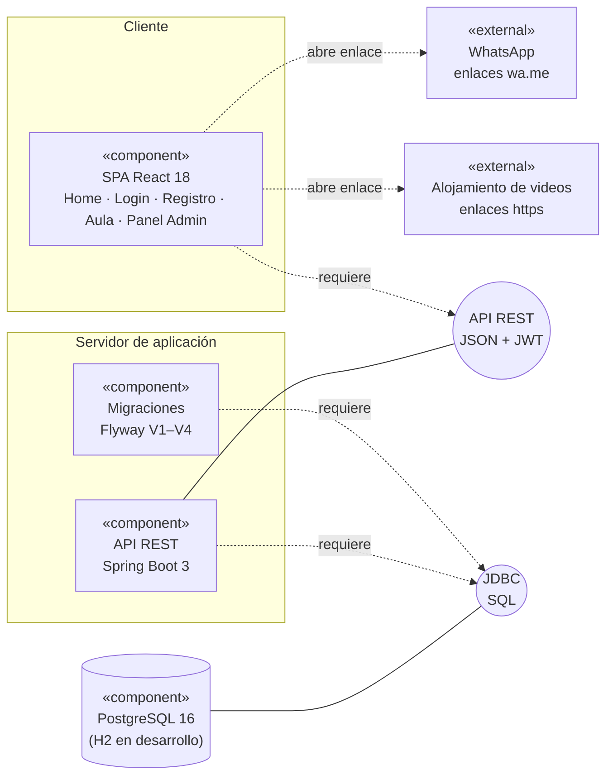
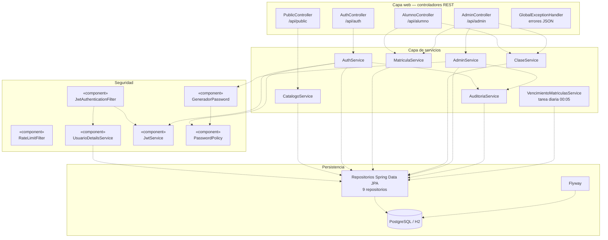
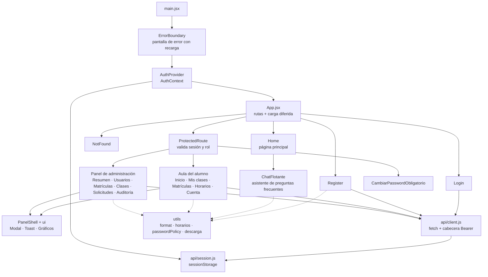
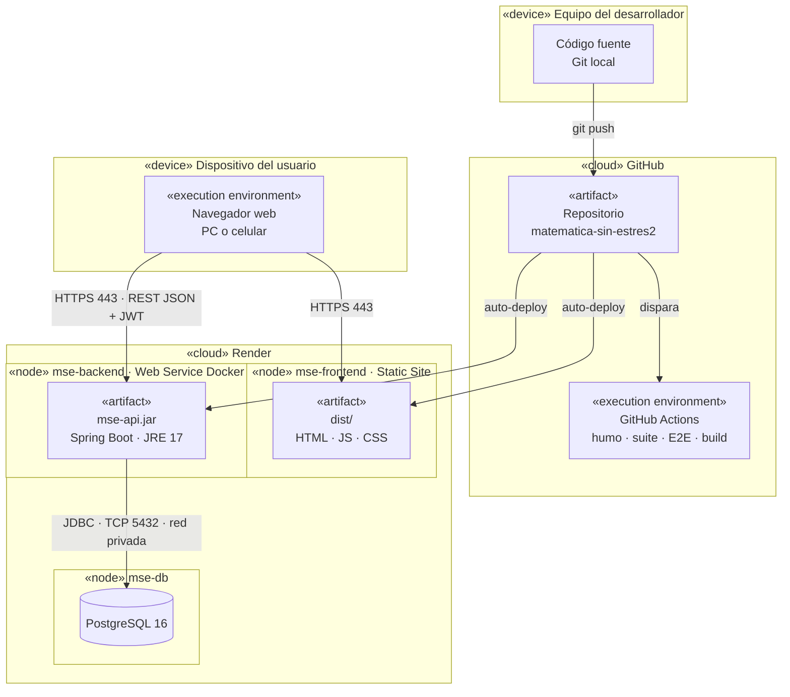
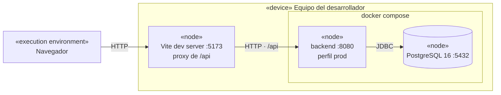

# 8. Diagramas de Componentes y de Despliegue

Los diagramas están escritos en **Mermaid**, así que GitHub los dibuja automáticamente. Para llevarlos al informe o a las diapositivas, copia el bloque en <https://mermaid.live> y exporta como PNG o SVG.

## 8.1 Notación usada

Siguiendo la notación UML que se enseña en el curso:

| Elemento | UML | Cómo se dibuja aquí |
|----------|-----|---------------------|
| **Componente** | Rectángulo con dos rectángulos pequeños en el lado izquierdo; es una parte modular del sistema cuyo funcionamiento interno es invisible para el entorno | Caja con el estereotipo `«component»` |
| **Interfaz** | Círculo pequeño unido por una línea continua al componente que la **provee** | Círculo (`(( ))`) unido con `---` al componente |
| **Dependencia** | Línea discontinua con flecha hacia el componente o la interfaz que **provee** el servicio | Flecha discontinua `-.->` |
| **Nodo** (despliegue) | Cubo: recurso de ejecución (computadora, dispositivo, memoria) | Recuadro con estereotipo `«node»`, `«device»` o `«execution environment»` |
| **Artefacto** | Archivo físico que se instala en un nodo | `«artifact»` dentro del nodo |
| **Conexión** (despliegue) | Línea entre nodos con el protocolo | Flecha con el protocolo y el puerto |

---

## 8.2 Diagrama de componentes — visión general del sistema

| Componente | Responsabilidad | Interfaz que provee | Interfaz que requiere |
|------------|-----------------|---------------------|-----------------------|
| SPA React | Presentación, navegación por rol, validación inmediata en el navegador | — | API REST |
| API REST | Autenticación, reglas de negocio, autorización, auditoría | API REST (JSON + JWT) | JDBC/SQL |
| Flyway | Crear y versionar el esquema y los datos iniciales al arrancar | — | JDBC/SQL |
| PostgreSQL | Persistencia (10 tablas: 9 de V1 + `progreso_clases` de V4) | JDBC/SQL | — |

## 8.3 Componentes internos del back-end

Las dependencias salen del código (constructores de los controladores y servicios). Los filtros de seguridad se ejecutan **antes** que los controladores en cada petición.

| Capa | Componentes | Responsabilidad |
|------|-------------|-----------------|
| Seguridad | `RateLimitFilter`, `JwtAuthenticationFilter`, `UsuarioDetailsService`, `JwtService`, `PasswordPolicy`, `GeneradorPassword` | Límite de peticiones por IP (429), validación del token, revalidación de la cuenta en cada petición, política y generación de contraseñas |
| Web | 4 controladores + `GlobalExceptionHandler` | Rutas REST por rol; traducción de cualquier error a JSON con el código HTTP correcto |
| Servicios | 7 servicios | Reglas de negocio: autenticación, matrículas, clases y progreso, catálogo público, administración, auditoría y vencimiento automático |
| Persistencia | Repositorios JPA, Flyway, BD | Consultas parametrizadas (mitiga inyección SQL) y esquema versionado |

## 8.4 Componentes internos del front-end

Las pantallas `Login`, `Register`, `Aula`, `Admin`, `NotFound` y `CambiarPasswordObligatorio` se cargan **bajo demanda** (`React.lazy`): quien solo visita la página principal no descarga el código del Aula ni del Panel.

---

## 8.5 Diagrama de despliegue — producción

| Nodo | Tipo | Artefacto | Configuración (variables de entorno) |
|------|------|-----------|--------------------------------------|
| Dispositivo del usuario | `«device»` | Navegador moderno | — |
| `mse-frontend` | Render Static Site | `frontend/dist` (build de Vite) | `VITE_API_URL`, `VITE_WHATSAPP_NUMBER` (se incrustan al compilar) |
| `mse-backend` | Render Web Service (Docker) | `mse-api.jar` en imagen `eclipse-temurin:17-jre`, usuario sin privilegios | `SPRING_PROFILES_ACTIVE=prod`, `JWT_SECRET`, `JWT_EXPIRATION_MINUTES`, `DB_*`, `CORS_ALLOWED_ORIGINS` |
| `mse-db` | Render PostgreSQL 16 | Esquema creado por Flyway al primer arranque | Credenciales inyectadas a `mse-backend` |
| GitHub Actions | `«execution environment»` | Flujo `.github/workflows/ci.yml` | Sin secretos: las pruebas usan H2 |

| Conexión | Protocolo | Seguridad |
|----------|-----------|-----------|
| Navegador → front-end | HTTPS 443 | TLS de Render; cabeceras `X-Frame-Options`, `nosniff`, `Referrer-Policy` |
| Navegador → API | HTTPS 443, REST/JSON | JWT en `Authorization: Bearer`; CORS restringido al dominio del front-end |
| API → base de datos | JDBC sobre TCP 5432 | Red privada de Render; credenciales por variables de entorno |

> **Restricciones del plan gratuito de Render:** la API se suspende tras 15 minutos sin uso (el primer acceso tarda ≈ 50 s) y la base de datos vence a los 30 días. Ver riesgos R1 y R2 en el [plan de pruebas](06-plan-de-pruebas.md#710-riesgos-y-contingencias).

## 8.6 Diagrama de despliegue — desarrollo local

Variante sin Docker: `mvn spring-boot:run` levanta la API en `:8080` con **H2 en memoria** (perfil `dev`), que es también el entorno de las pruebas automatizadas.
